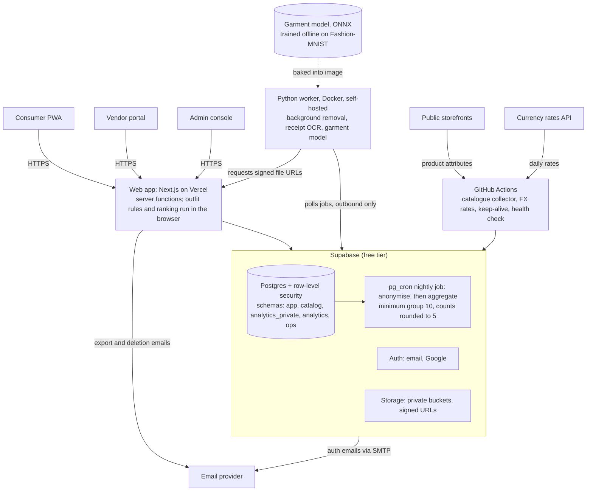

# Sparta

**Your wardrobe, digitised, with a privacy-first insights layer for the brands and retailers who make and sell clothes.**

Sparta is a free web app (installable as a PWA) where men catalogue their clothes and accessories, build outfits, record what they bought and where, and plan future purchases. Anonymised, aggregated data from pilot users gives brands and retailers a demand signal for planning ranges and stock, instead of relying on gut feeling.

This is an open-source, academic proof of concept. The current phase is a **3-month pilot** that builds a real dataset from organic app use and tests whether it produces vendor insights worth having. The pilot aims for about 100 users and at least one vendor; these are indicative, not hard targets.

## Who it is for

| Audience | What they get |
| --- | --- |
| **Consumers** (men, 18 and over, English only for now) | A free digital wardrobe with outfit building, outfit suggestions from a recommendation engine, purchase history with receipts, a wishlist and planning. The pilot is by invitation, in the countries where it is open (initially India). |
| **Vendors** (brands, manufacturers and retailers) | Aggregate dashboards, gap and demand insights, and product feed upload. Invited by the team, read-only. |

## Consumer features (pilot)

- **See and organise everything you own:** browse, filter by any attribute and sort by the main ones, custom tags and collections, favourites, a "never worn" flag, archive (sold, donated, discarded, lost).
- **Four ways to add items:** a seed catalogue of popular items; a manual form; photo upload with automatic background removal and a suggested category from a small image model; receipt scan with OCR (always shown as an editable draft).
- **Full colour spectrum:** pick any colour; Sparta derives a colour family so that near-identical shades group together.
- **Condition rating:** rate each item from 0 (brand new) to 100 (falling apart).
- **Outfits:** a slot-based builder, up to three suggestions for an occasion and season from the recommendation engine (style rules plus ranking), each with a one-line reason and a most-similar-first swap list, and a planning calendar. Logging "what I wore" is optional and never prompted.
- **Purchases and wishlist:** record when, where and for how much you bought something, attach receipts, keep a wishlist and plan purchases by month and budget. Prices keep their original currency.
- **Your data, your control:** export all of your data and delete your account at any time.

## Vendor features (pilot)

- **Dashboard:** ownership mix by category, colour family, fit and brand; purchase and wishlist trends over time; gaps (high wishlist demand, low ownership); a condition spectrum that hints at replacement demand; filters by size, season, price band and region.
- **Gap and demand report:** a monthly report reviewed by the team before the vendor sees it.
- **Product feed upload:** vendors can upload their catalogue so their items appear in the app.

## Privacy

Vendor insights depend on trust, so privacy rules are built into the design and enforced in the database.

1. **The pilot is a study, and sharing is part of taking part.** On first login each user sees a plain-language notice explaining that the pilot is a free 3-month study run by a student team and that anonymised group figures are shared with vendors, and must accept it to use the app. The sharing setting is visible but locked on during the pilot, with an explanation. A **Leave the pilot** button deletes the account and data at any time, with no reason needed. No data is used to train AI models.
2. **The shipped product will differ.** Users will be able to disable sharing. The default state is still to be decided before any wider launch.
3. **Aggregated only.** Vendors never see individual users, wardrobes, photos, receipts, notes or purchase records.
4. **Minimum group size.** A segment is shown only when at least 10 users contribute during the pilot (50 in production). Counts are rounded to the nearest 5, and neighbouring segments are hidden where needed to stop figures being worked out by subtraction.
5. **Minimal data.** Only the fields the app needs are collected. Images and receipts are never part of any shared dataset.
6. **Seed catalogue data.** Product attributes only, from sources that allow collection (checked against `robots.txt` and terms), collected politely and with links back to the source. Product images are not copied.

The pilot is invitation-only, adults only, and limited to supported countries. The privacy and legal documents in [`legal`](legal) were drafted without a lawyer for this academic proof of concept; they are not legal advice, and a professional review is required before any public or commercial launch.

## How it is built



*Source: HLD section 3 (Figure 1) and section 5.8. A dashed arrow is offline work done before the pilot.*

- **Free or near-free hosting:** Supabase and Vercel free tiers, GitHub Actions, and a self-hosted worker container.
- **Privacy in the database:** row-level security on every user table, consent checks, vendor access only through functions that apply the group-size rules.
- **Python where it counts:** a Python worker from the start, which also runs the small garment model behind photo suggestions.
- **A recommendation engine built before there is data:** style rules and ranking run in the browser; the garment model is trained once, offline, on the public Fashion-MNIST dataset (kept out of the repository, see [`data/recommendation-engine`](data/recommendation-engine)). Nothing is trained on participants.

Full detail is in the design documents below.

## Data used before the pilot

The pilot has not produced data yet. Until it does, the team works with two public datasets. Neither is committed to this repository, because of file size and licence terms.

| Dataset | What it is used for | Size | Licence |
| --- | --- | --- | --- |
| [H&M Personalized Fashion Recommendations](submissions/D2/) (Kaggle) | A stand-in for purchase behaviour and seasonal demand in the course analytics (ANCP D2 to D5) | 105,542 articles; 1,371,980 customers; 31.8 million transactions (20 Sep 2018 to 22 Sep 2020) | Competition rules: non-commercial research and education only |
| [Fashion-MNIST](data/recommendation-engine/) (Zalando Research) | Trains the small garment model that suggests a category for photo items | 70,000 greyscale 28 × 28 pictures in 10 garment types (60,000 train, 10,000 test) | MIT |

- **Working sample:** all purchases of a random 10% of customers, which is 136,670 customers and 3,205,663 rows. It matches the full file on every check in the D2 report.
- **Cleaned dataset `data-v1.0`:** 3,066,344 units from 132,435 customers, of which 5.8% are Menswear. [`clean_hm.py`](submissions/D2/clean_hm.py) rebuilds it, and every column is described in [`data_dictionary.csv`](submissions/D2/data_dictionary.csv).
- **Limits:** H&M shows purchases only, by mostly European shoppers, with no gender field. It cannot show ownership, wishlist demand or Indian menswear. Fashion-MNIST says nothing about which clothes go together. The Sparta pilot extract replaces H&M as soon as it exists.

## Data dictionary

The cleaned H&M dataset `data-v1.0` has three files. The full dictionary, with the source column behind each field, is in [`submissions/D2/data_dictionary.csv`](submissions/D2/data_dictionary.csv). Feature numbers refer to D2 report Table 7.

<details>
<summary><code>lines_clean.csv.gz</code> (16 columns)</summary>

| Column | Type | Description | Missing values |
| --- | --- | --- | --- |
| `t_dat` | date | Purchase date (YYYY-MM-DD) | None |
| `week_start` | date | Monday of the purchase week (D2 Table 7 feature 7) | None |
| `customer_id` | text | 64-character hash from the publisher; joins to customers_clean | None |
| `article_id` | text | 10-digit article id with leading zeros; joins to articles_clean | None |
| `price` | number | Normalised unit price; relative use only, not a currency | None |
| `sales_channel_id` | integer | Anonymous channel code, 1 or 2; never labelled store or online | None |
| `qty` | integer | Units in this line: identical rows on the five transaction columns collapsed into one (D2 decision 1; Table 7 feature 1) | None |
| `role` | text | Top, Bottom, Full-body, Accessory, Footwear, Hosiery, Underwear, Nightwear, Swimwear (Table 7 feature 2) | None: unmapped (non-apparel) groups are dropped |
| `is_menswear` | boolean | True when the article's index group is Menswear (a proxy, not a gender label; Table 7 feature 3) | None |
| `index_group_name` | text | Department: Ladieswear, Divided, Menswear or Sport (Baby/Children dropped) | None |
| `product_group_name` | text | Catalogue product group | None |
| `product_type_name` | text | Catalogue product type | As in source |
| `garment_group_name` | text | Catalogue garment group | As in source |
| `perceived_colour_master_name` | text | Catalogue master colour | As in source |
| `perceived_colour_value_name` | text | Catalogue colour shade (for example Dark) | As in source |
| `age_band` | text | 18-24, 25-34, 35-44, 45-54, 55-64, 65+ or unknown (under-18 customers are removed) | unknown |

</details>

<details>
<summary><code>customers_clean.csv.gz</code> (7 columns)</summary>

| Column | Type | Description | Missing values |
| --- | --- | --- | --- |
| `customer_id` | text | 64-character hash; one row per customer who remains in scope | None |
| `FN` | integer | Publisher flag, 0 or 1 (Table 7 feature 5) | Stored as 0 |
| `Active` | integer | Publisher flag, 0 or 1 (Table 7 feature 5) | Stored as 0 |
| `club_member_status` | text | ACTIVE, PRE-CREATE, LEFT CLUB or UNKNOWN (Table 7 feature 6) | UNKNOWN |
| `fashion_news_frequency` | text | NONE, Regularly, Monthly or UNKNOWN; source value None merged into NONE (Table 7 feature 6) | UNKNOWN |
| `age_clean` | number | Age; values above 90 set to missing (Table 7 feature 4) | Empty |
| `age_band` | text | 18-24, 25-34, 35-44, 45-54, 55-64, 65+ or unknown (Table 7 feature 4) | unknown |

</details>

<details>
<summary><code>articles_clean.csv.gz</code> (9 columns)</summary>

| Column | Type | Description | Missing values |
| --- | --- | --- | --- |
| `article_id` | text | 10-digit article id with leading zeros; one row per article in the lines file | None |
| `product_type_name` | text | Catalogue product type | As in source |
| `product_group_name` | text | Catalogue product group | None |
| `perceived_colour_master_name` | text | Catalogue master colour | As in source |
| `perceived_colour_value_name` | text | Catalogue colour shade | As in source |
| `index_group_name` | text | Department | None |
| `garment_group_name` | text | Catalogue garment group | As in source |
| `role` | text | Outfit role derived from product_group_name | None |
| `is_menswear` | boolean | True when index_group_name is Menswear | None |

</details>

<details>
<summary>Derived features that are not stored (10)</summary>

| Where | Feature | Status | Description |
| --- | --- | --- | --- |
| (filter only) | `is_minor` | used to filter; not stored | Age under 18; used to drop under-18 customers (Table 7 feature 8) |
| D3 notebook | `visit` | derived in D3; not stored | One customer on one day (Table 7 feature 9) |
| D3 notebook | `single_unit_visit / top_and_bottom_visit` | derived in D3; not stored | Visit has one unit; visit has both a Top and a Bottom role (Table 7 feature 10) |
| D3 notebook | `history_hit` | derived in D3; not stored | Customer bought the same article, type, colour or department on an earlier day; built only from earlier days (Table 7 feature 11) |
| D3 notebook | `pair_lift` | derived in D3; not stored | Visits with both product types divided by the count expected when items are shuffled among visits of the same size and week (Table 7 feature 12) |
| D3 notebook | `top100_weekly_overlap / new_article_share` | derived in D3; not stored | Jaccard overlap of the top 100 articles at 1/4/13/52 weeks; share of units from articles first sold up to 8 weeks earlier (Table 7 feature 13) |
| D3 notebook | `customer_activity` | derived in D3; not stored | Visits, units, single-unit share and distinct product types per customer; rebuild inside the training window for modelling (Table 7 feature 14) |
| Sparta pilot data | `colour_family` | planned for pilot | Nearest reference swatch in CIELAB to the colour the user picks (Table 7 feature 15; HLD 6.3) |
| Sparta pilot data | `condition_band` | planned for pilot | Condition 0-100 grouped into 0-9, 10-29, 30-59, 60-84, 85-100 (Table 7 feature 16) |
| Sparta pilot data | `gap_score` | planned for pilot | Distinct users with an open wishlist entry in a segment divided by distinct users who own an item in it (Table 7 feature 17) |

</details>

## Repository structure

```
sparta/
├── README.md                      this file
├── LICENSE                        GPL-3.0
├── docs/                          design documents
│   ├── BRD.md                     business requirements
│   ├── FDD.md                     functional design (screens, rules, engine)
│   ├── HLD.md                     high-level design (architecture)
│   ├── LLD.md                     low-level design (tables, policies, jobs)
│   └── ANCP_TM_D1_v1.pdf          ANCP D1 project charter
├── legal/                         pilot legal and privacy pack (drafts, not legal advice)
├── data/
│   └── recommendation-engine/     Fashion-MNIST source, licence and checksums (CSVs git-ignored)
├── flow-diagrams/                 process flow and D2 data flow (PNG, with HTML sources)
├── prototype/
│   └── sparta_prototype.html      low-fidelity prototype, opens in a browser
└── submissions/                   ANCP course deliverables
    ├── D2/                        data audit: report, clean_hm.py, data_dictionary.csv, report source
    └── D3/                        EDA notebook, HTML export, insight summary
```

There is no application code yet. The planned code layout (web app, worker, rules package, database migrations) is in HLD section 12.

## Documents

| Document | Purpose |
| --- | --- |
| [Business Requirements (BRD)](docs/BRD.md) | What the business needs and why; scope, requirements, risks |
| [Functional Design (FDD)](docs/FDD.md) | What the system does, screen by screen and rule by rule |
| [High-Level Design (HLD)](docs/HLD.md) | Architecture, components, security, deployment |
| [Low-Level Design (LLD)](docs/LLD.md) | Tables, policies, functions, worker, API routes, tests, operations |
| [Legal and privacy pack](legal/README.md) | Privacy policy, terms of use, vendor pilot agreement, incident plan, privacy risk assessment, data sourcing policy, privacy contact address and review log (pilot drafts, not legal advice) |
| [ANCP D1 project charter](docs/ANCP_TM_D1_v1.pdf) | The course charter that frames this project (Group M) |
| [Flow diagrams](flow-diagrams/) | Process flow (outfit recommendation and inventory planning) and the D2 data flow |
| [ANCP D2 data audit](submissions/D2/) | Audit report and datasheet, cleaning script, data dictionary (public H&M data as a proxy before the pilot) |
| [ANCP D3 EDA](submissions/D3/) | EDA notebook, HTML export and two-page insight summary |
| [Low-fidelity prototype](prototype/sparta_prototype.html) | One HTML page, opened locally in a browser. It shows a clickable data-workflow diagram, four wireframe screens (pilot notice, wardrobe, outfit suggestions running the FDD 14.1 rules, vendor gaps) and the D2 data figures. The wardrobe and vendor numbers are made-up examples, and the ranking weights are placeholders until FOI-9 is closed |
| [Recommendation engine data](data/recommendation-engine/) | Source, licence and checksums of the Fashion-MNIST files (the files themselves are git-ignored) |

## Out of scope for the pilot

Native iOS and Android apps; paid AI features, inspiration matching and a style chat assistant; training, tuning or personalising any model on participant data; outfit inspiration from photos, links or feeds, and wishlist suggestions to complete a look; womenswear and other audiences; payments, affiliate links, sponsored promotions and vendor billing; email or inbox-based receipt import; and languages other than English. Some of these may follow after the pilot (see BRD section 4.2).

## Status

The design documents (BRD, FDD, HLD, LLD) are final; each lists its remaining open items. The legal and privacy pack is a set of pilot drafts and is not legal advice. The charter is the course document already submitted. Implementation has not started, so there is no application code in this repository yet. The recommendation engine was added to the pilot design on 2026-10-29 (BRD section 7.5, FDD section 14). The ANCP D2 data audit and D3 exploratory data analysis were submitted on 2026-11-03, using the public H&M data. Still open: the ranking weights and the review of sample suggestions by the style specialist (FDD FOI-9), and the `data-v1.0` release tag with its `MANIFEST.json` (see [`submissions/D2`](submissions/D2/)). Build order and milestones are in section 14 of the LLD.

## Contributing

Open an issue or pull request. Do not commit secrets or personal data. Changes to security policies or vendor-facing functions need a database test and a review.

## Licence

Licensed under the GNU General Public License v3.0. See [LICENSE](LICENSE).
