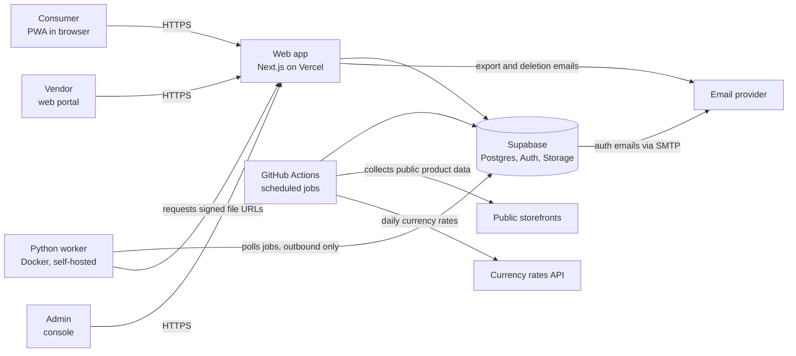
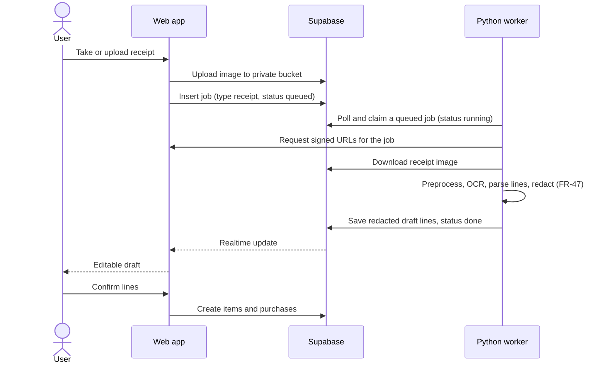
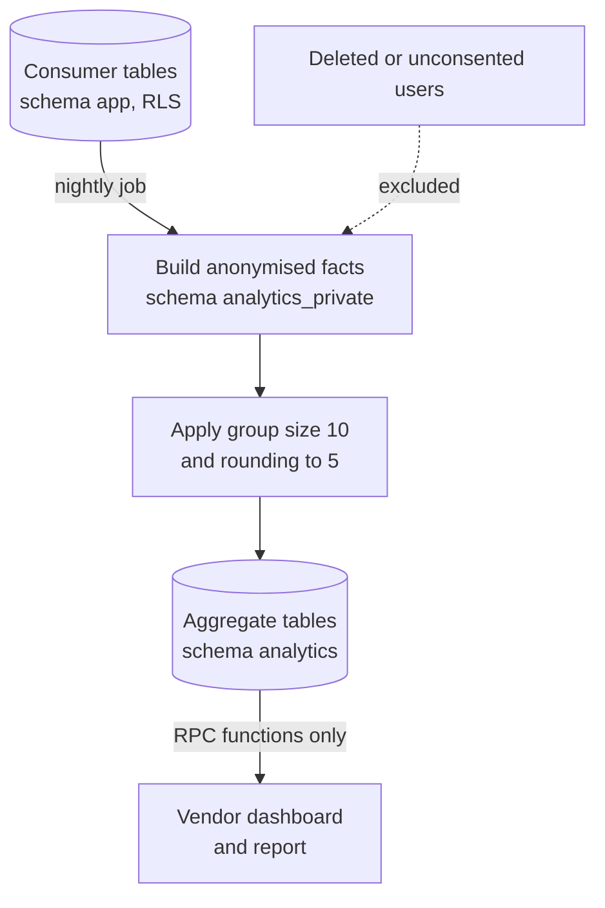
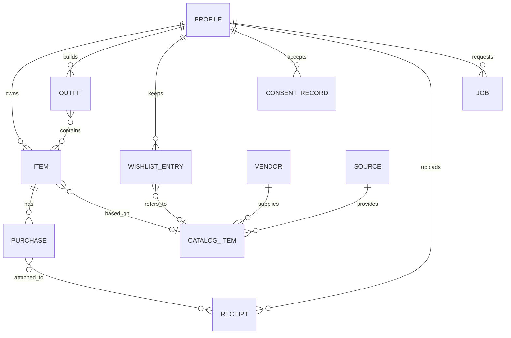

# Sparta: High-Level Design (HLD)

| Field | Value |
| --- | --- |
| Document | High-Level Design |
| Version | 1.2 (final; amended after the full document review) |
| Date | 2026-10-22 |
| Author | Business analyst (drafted for the product owner) |
| Reviewer | C. Prashanth (Solution Architect) |
| Approver | Ambarish Sengupta (Product Owner) |
| Traces to | BRD v1.2 (BR-xx), FDD v1.3 (FR-xx, NFR-xx); legal pack in `legal` |
| Status | Final |

## 1. Purpose and scope

This document describes the architecture of the Sparta pilot: the main components, how they interact, where data lives, how privacy is enforced, and how the system is deployed. Class-level and table-level detail is in the LLD. LLD section 16 (LD-1 to LD-7) lists where the LLD refines or departs from this document.

## 2. Design drivers

| Driver | Source | Effect on the design |
| --- | --- | --- |
| Free or under about $20 a month in total | BR-42, BRD section 8 | Managed free tiers (Supabase, Vercel, GitHub Actions) and a self-hosted worker container on a team member's always-on machine. Expected cost is zero. |
| Team of three, 3-month pilot | BRD section 8 | Few moving parts; one language for the web app; reuse of managed auth, storage and database. |
| About 100 users, room to grow to 500 | FDD NFR-7 | Simple relational design; no distributed systems. |
| Vendors must never see individual data; minimum group of 10 | BR-25, BR-26 | Privacy enforced in the database, not only in the application. |
| Consent recorded; delete and export on request | BR-20 to BR-24 | Consent table, deletion cascade, export built by a server function. |
| Web first, installable PWA | BR-13 | Single responsive web app; no native clients in the pilot. |
| Open source under GPL-3.0 | BR-43 | No secrets in the repository; configuration by environment; only components that can be self-hosted. |
| Python for later ML | Earlier product decision | A Python service exists from the start for image, OCR and later ML work. |
| Image and receipt processing | BR-05, BR-06 | Open-source tools in a Python worker. |

## 3. Architecture overview

The design uses four building blocks.

1. **Web app** (Next.js, TypeScript) on Vercel. One codebase serves the consumer PWA, the vendor portal and the minimal admin console, separated by role and route.
2. **Supabase** for Postgres, authentication, file storage, row-level security (RLS) and scheduled database jobs.
3. **Python worker** (FastAPI app in a Docker container, self-hosted on a team member's always-on machine) for background removal, receipt OCR and parsing, and later ML. It pulls its jobs from the database; nothing connects in to it.
4. **Scheduled jobs** on GitHub Actions for catalogue collection and housekeeping.



*Figure 1. System context and main components.*

### 3.1 Why this shape

- **Most of the app is CRUD** (wardrobe, wishlist, outfits, purchases). With Supabase and RLS, the browser can read and write the user's own rows directly and safely, which removes a whole API layer to build.
- **Heavy and Python-native work stays out of the web tier.** Background removal and OCR need large libraries and memory that serverless web functions handle poorly.
- **Aggregation runs inside Postgres.** Counting distinct users per segment, applying the minimum group size and rounding are set operations, and doing them next to the data keeps raw rows from ever leaving the database.

## 4. Component responsibilities

| Component | Responsibilities | Main requirements |
| --- | --- | --- |
| **Web app, consumer area** | Sign-in and onboarding, pilot notice, wardrobe, filters, item entry, purchases, wishlist, outfit builder and suggestions, calendar, settings, export and delete. Offline caching of viewed pages (service worker). | FR-1 to FR-69, NFR-1 to NFR-5 |
| **Web app, vendor area** | Vendor Pilot Agreement acceptance, dashboard, gaps, report view, feed upload and validation. Reads insights only through the aggregate functions; the only rows it writes are the vendor's own feed items (through a server function), agreement acceptances and its own usage events (FDD section 16). | FR-70 to FR-95 |
| **Web app, admin area** | Vendor and participant invitations, supported countries, catalogue sources, aggregate run monitor, vendor query log, deletion queue, report review. | FR-8, FR-9, FR-69, FR-79, FR-86, FR-88, FR-100 to FR-104 |
| **Web server functions** (Vercel route handlers) | Operations that must run on the server: manage the invitation list and invite vendors, delete accounts (including Leave the pilot), build exports and return signed download links, issue short-lived signed storage URLs to the worker for the job it is running, validate and publish vendor feeds, generate and review reports, and the daily housekeeping run. Those that need the Supabase secret key use it only here; it is never sent to the browser. | FR-8, FR-62, FR-63, FR-66, FR-70, FR-79, FR-90 to FR-92 |
| **Outfit suggestion logic** | Rule engine running in the web app from a shared rules file, using the user's own items. No server needed. | FR-52 to FR-54, section 14 of FDD |
| **Supabase Auth** | Email and password plus Google sign-in, email verification, sessions, roles. Apple sign-in is deferred (needs a paid Apple developer account). | FR-1, FR-70 |
| **Supabase Postgres** | All structured data, RLS, aggregate functions, scheduled jobs (`pg_cron`). | all |
| **Supabase Storage** | Private buckets for item images, receipts and exports; signed URLs only. | FR-23, FR-32, FR-46, FR-62 |
| **Python worker** | Polls the `jobs` table for queued photo and receipt jobs, runs background removal, compression and thumbnails, or PaddleOCR, line parsing and redaction, and writes results back. Stateless, outbound connections only; a limited database role for the job queue, and files only through short-lived signed URLs, never the Supabase secret key (LLD 7.1, LD-3). Later also ML. Its host also runs the weekly encrypted database backup, outside the worker container (section 8); backups are never stored as GitHub Actions artifacts. | FR-23, FR-40 to FR-45, FR-47, NFR-8 |
| **GitHub Actions** | Scheduled catalogue collection from approved sources, taxonomy mapping, daily exchange-rate fetch, a daily uptime ping to keep the free database from pausing, daily housekeeping (export expiry, deletion retries), and a health check every 6 hours that alerts the team. | FR-33, FR-64, FR-100 to FR-104 |
| **Currency rates API** | Daily rates for display conversion and for the price bands in the aggregates (a free, keyless source such as the ECB-based Frankfurter service). Fetched by a scheduled GitHub Actions job and stored in the database. | FR-33 |
| **Email provider** | Transactional email only: vendor portal invitations, verification, password reset, export ready, deletion confirmation, end-of-pilot notice (FR-69). Supabase Auth sends through it as custom SMTP; the web server functions send the rest. | FR-60, FR-62, FR-63, FR-70 |

## 5. Key flows

### 5.1 Item with a photo (FR-23)

1. The browser resizes the image to at most 1,200 pixels on the long side, re-encoding it so that no EXIF metadata (such as GPS location) is kept, and uploads it to the private item-images bucket.
2. The web app inserts a job row (type photo, status queued). The worker picks it up on its next poll (every few seconds).
3. The worker removes the background, saves a compressed WebP cut-out and 320-pixel WebP thumbnails of the cut-out and of the original to storage, and marks the job done.
4. The browser shows the preview. The user accepts or keeps the original, completes the attributes and saves. The image not chosen and its thumbnail are then deleted, so each photo item keeps one full-size image and one thumbnail.

### 5.2 Receipt scan (FR-40 to FR-47)



*Figure 2. Receipt scan sequence.*

Nothing is created in the wardrobe until the user confirms (FR-42). If the worker machine is offline, jobs stay queued and run when it returns; the interface shows a "processing" state, and after two minutes offers manual entry instead (FR-45). A job that fails or stalls is attempted at most three times in all, then marked failed and the user is offered manual entry; a receipt with no readable lines is not retried.

### 5.3 Pilot notice and consent (FR-3 to FR-5)

On login the app reads the user's latest consent record. If none exists for the current notice version, a blocking pop-up is shown. Accepting writes a row (user, notice version, time) to the consent table. Until it exists, RLS policies deny access to all consumer data except the user's own profile, consent records and acceptances, so the rule holds even if the client is changed. The same check also requires acceptance of the current Terms and Privacy Policy, a confirmed age and a country on the supported list (LLD 4.9).

### 5.4 Aggregation and vendor views (FR-72 to FR-86)



*Figure 3. Aggregation flow.*

- A nightly `pg_cron` job builds an anonymised fact table: one row per owned, wishlisted or purchased item, with attributes (category, colour family, fit, brand, size, season, price band, condition band, region) and a salted hash in place of the user ID. No names, emails, images, receipts, notes or outfit logs enter it.
- The job computes segment counts by distinct hashed user, drops segments below 10, rounds counts to the nearest 5, and writes the results to aggregate tables.
- Vendors reach aggregate data only through database functions in `analytics`, and each function checks the caller's role. Supabase gives every signed-in user, consumer or vendor, the same database role. So vendors are kept out of consumer data in `app` by RLS policies that require the consumer role, and out of `analytics_private` and the aggregate tables because those are not exposed and have no grants. Apart from these functions, a vendor can read only their own account records (profile and acceptances) and the taxonomy lookups (LLD 10, LD-1).
- The salt rotates every run, so the hashes cannot be joined across runs.
- Each run writes an audit row (FR-86).

### 5.5 Account deletion and export (FR-62 to FR-64)

- **Delete:** a server function re-authenticates the user, marks the profile as deleting, then deletes the user's rows (foreign keys cascade from the profile), the user's invitation entry, the user's storage objects and finally the auth user. Only the user ID and the deletion time are kept, in a deletion log used after any restore from backup (section 8). A daily housekeeping job (GitHub Actions calling a protected server route) retries any unfinished deletion, and the health check every 6 hours (section 10) alerts the team when one is older than 5 days, so the 7-day target (FR-64) is met.
- **Export:** a server function assembles the user's data (JSON) and files into one or more zip files in the private exports bucket, each under the free plan's 50 MB file limit. The user gets a link for each file in the app, and an email that links to the in-app export page. The worker is not involved, so it never reads a user's full data. Each user has one export at a time, and export files are deleted after 7 days by the same housekeeping job.

### 5.6 Catalogue collection (FR-100 to FR-104)

A scheduled GitHub Actions job runs a Python collector that reads only from sources marked allowed in the sources table, checks `robots.txt`, rate-limits, identifies itself, extracts attributes and the product URL (not images), maps them to the shared taxonomy, and upserts catalogue items. Unmapped rows go to a review queue in the admin console.

### 5.7 Vendor feed upload (FR-90 to FR-93)

The vendor uploads a CSV or JSON file. A server function validates every row against the shared taxonomy and shows errors. On confirmation the rows are written as vendor catalogue items owned by that vendor.

## 6. Data architecture

### 6.1 Schemas

| Schema | Contents | Who can read |
| --- | --- | --- |
| `app` | Profiles (including the `deleting` flag behind the admin deletion queue), items, purchases, receipts, wishlist, outfits (with plans and logs), collections, tags, suggestion feedback, analytics events, pilot-notice consent records, Terms and Privacy Policy acceptances, jobs | The owning user (RLS and the consent gate, section 5.3); the service role |
| `catalog` | Taxonomy lookup tables (including colour swatches and the country-to-region map), catalogue items (from approved sources or vendor feeds), sources, vendors and their members, vendor agreement acceptances | Lookup tables: all signed-in users. Active catalogue items: eligible consumers (consent gate). Agreement acceptances: the vendor's own members. Sources, and vendors' changes to their own items: the service role through server functions only |
| `analytics_private` | Anonymised fact table (hashed user, attributes only) | The aggregation job only |
| `analytics` | Aggregate tables and the functions vendors call | Vendors through functions only |
| `ops` | Settings (document versions, supported countries, minimum group size), invitation list, aggregate run audit, vendor query log, report snapshots, FX rates, worker heartbeat, deletion log (user IDs and times only) | No direct access: the service role in server functions (admin console) and fixed database functions only; vendors see reviewed reports only through `analytics` functions |

### 6.2 Core entities



*Figure 4. Core entities.*

### 6.3 Shared taxonomy

The taxonomy (categories, sub-types, colour families, fits, materials, patterns, seasons, occasions, condition bands) lives in one versioned JSON file in the repository. It is loaded into database lookup tables, and used by the web app forms, the worker, the collector and the feed validator, so that every source speaks the same vocabulary (BR-40).

**Colour.** Users pick any colour on a spectrum, and the item stores it as RGB (`colour_r`, `colour_g`, `colour_b`, plus a hex string). A database function derives `colour_family` by finding the nearest reference swatch in CIELAB space, and a trigger refreshes it whenever the colour changes. The same function runs in the collector and the feed validator for source colour names or hex codes. Filters, outfit rules and every vendor aggregate use the family; the exact RGB value is used only for display, tinting illustrations, similar-colour search and the chroma (colourfulness) checks in the outfit rules. Alpha is not stored, because fabric colours are opaque.

### 6.4 Storage budget

Item photos are resized to 1,200 pixels in the browser. The worker stores the cut-out as WebP with a 320-pixel thumbnail, and the image the user does not choose is deleted when the item is saved. Receipt photos are resized in the browser to at most 2,000 pixels on the long side; PDFs keep the 8 MB limit. Each user has one export at a time.

| Item | Assumption | Estimate |
| --- | --- | --- |
| Item images | 100 users x 60 items x about 80 KB (one full-size image per item) | about 480 MB |
| Thumbnails | 100 users x 60 items x about 10 KB | about 60 MB |
| Receipts | 100 users x 10 receipts x about 250 KB | about 250 MB |
| Exports | One export per user, kept 7 days; about 20 users exporting in the same week x about 8 MB | about 160 MB |
| Database rows | Small | under 50 MB |

The free Supabase plan includes about 1 GB of file storage and 5 GB of egress a month per organisation, and 500 MB of database per project. File storage comes to about 0.95 GB, which is at the limit. Three controls apply from the start: an 8 MB cap per user on item images and receipts (LLD 4.6), which bounds them at about 800 MB for 100 users; the 80% usage check in the scheduled health check (section 10, LLD 13.1); and a separate organisation for the dev project (section 8). Section 11 lists the fallbacks.

## 7. Security and privacy architecture

| Concern | Design |
| --- | --- |
| Authentication | Supabase Auth with verified email; Google sign-in; strong password rules. |
| Authorisation | Each user's role (`consumer`, `vendor` or `admin`) is stored in `app.profiles.role` and can be changed only by the service role. It is also copied into the token for the interface, but RLS policies read the database value (LLD 10). RLS on every table in `app` so users reach only their own rows. |
| Consent gate | RLS denies consumer access until a consent record exists for the current notice version (section 5.3). |
| Invitation and region control | Sign-up is refused unless the email is on the invitation list (a Supabase Auth hook that runs before an account is created). Onboarding refuses countries not on the supported list. The supported-country check is part of the consent check, so an account outside the allow-list can read only its own profile, consent records and acceptances (LLD 4.9). The invitation is checked only at sign-up: removing an email from the list does not lock an existing account. |
| Vendor probing | Every vendor function logs the call and refuses beyond 200 calls an hour; the admin console shows the log (LLD 5.7). |
| Vendor agreement | A vendor user must accept the current Vendor Pilot Agreement before the portal opens, and again when its version changes. Acceptance is recorded with the vendor, user, version and time, and every vendor function refuses the call until it exists (FR-94; LLD 4.9, 5.4). |
| Receipt privacy | Card numbers, emails, phone and loyalty numbers are masked and address lines dropped; raw scan text is never stored; results are deleted after 7 days (LLD 7.4). |
| Vendor isolation | Vendors share the signed-in database role with consumers, so isolation rests on four controls: RLS policies on `app` that require the consumer role; no API exposure and no grants for `analytics_private` and `ops`; no grants on the `analytics` tables; and a role check inside each vendor function. Apart from those functions, a vendor reads only their own account records and the taxonomy lookups (LLD 10, LD-1). |
| Minimum group size | Enforced inside the aggregation job and again inside each vendor function (defence in depth). |
| Rounding and differencing | Counts rounded to 5; filter combinations that would expose a small group are suppressed (FR-82). |
| Pseudonymisation | Hash with a per-run salt; never stored with the output. |
| Secrets | The Supabase secret key is only in Vercel's server-side environment. The worker host holds the worker's limited database role, the signing-route secret and the separate read-only backup login. GitHub holds the limited-role connection strings, the tokens for the scheduled server calls and the deploy credentials (LLD 12.3, LD-3). No secret goes in the repository or the browser. |
| Worker machine | Self-hosted worker: no inbound ports, encrypted disk, automatic updates, temporary files purged after each job. The worker has a limited database role (job queue, catalogue lookups, heartbeat) and reaches files only through short-lived signed URLs from an HMAC-authenticated server route for the job being run, so the Supabase secret key is never on the machine. The host also runs the weekly backup with a separate read-only database login, which can read all data, and keeps the encrypted backups; the key that decrypts them is never on the host (LLD 13.3). The database passwords and the signing secret are rotated if the machine is lost or changed. |
| Files | Private buckets, short-lived signed URLs, path prefix by user ID. Images are re-encoded in the browser before upload, which removes EXIF metadata such as GPS location (LLD 9.4). |
| Transport and storage | TLS everywhere; managed encryption at rest by the providers. |
| Input handling | Validated schemas on forms and feed files; upload size and type limits; the worker never executes uploaded content. |
| Scraping conduct | `robots.txt` check, rate limit, identifying user agent, source records (FR-100, FR-101). |
| Logging | No personal data or free text in logs; aggregate run audit kept. |
| Open-source hygiene | Secret scanning in CI; sample environment file only. |

Threats considered: a user reading another user's data (RLS tests), a vendor probing small groups (thresholds, rounding, suppression of differences), secret key leaks (server-only use, rotation), abusive uploads (limits), and consent bypass by a modified client (RLS gate).

## 8. Deployment and environments

| Environment | Web | Database and storage | Worker |
| --- | --- | --- | --- |
| Local | `next dev` | Supabase CLI (local containers) | `docker compose` |
| Preview | Vercel preview per pull request | The dev Supabase project | Optional (a local worker pointed at the dev project) |
| Pilot (production) | Vercel production | Prod Supabase project | Container on a team member's always-on machine (self-hosted, HOI-1a) |

- **Web:** Vercel Hobby. Its terms limit the Hobby plan to non-commercial use, which fits an academic pilot and should be revisited before any paid vendor tier. Vercel Functions default to Washington, D.C. (`iad1`), so the project must be set to Mumbai (`bom1`), to keep function calls next to the database and personal data in India. Hobby allows a single member, so one team member holds the Vercel project; how the others cover for that holder is set out in the Incident Response Plan (`legal`, section 8).
- **Database:** two free Supabase projects (dev and prod), each in its own free organisation because the free plan counts file storage, egress and monthly active users per organisation, and both in **South Asia (Mumbai), `ap-south-1`**. The pilot is India-only, so Mumbai keeps latency low and the data in India. The region cannot be changed after a project is created without migrating it, so choose it when creating the projects. The same region appears on the About page (FR-67) and in the Privacy Policy.
- **Worker host (decision made, HOI-1a):** the worker is a Docker container (`docker compose`, restart policy `always`) running on a team member's always-on machine. Free hosted options were ruled out: Render's free web service (512 MB RAM, 0.1 CPU, spins down after 15 minutes) is too small for PaddleOCR plus background removal, and Hugging Face Docker Spaces now need a paid PRO plan (about $9 a month). The container needs roughly 2 GB of memory. Because the worker polls Supabase and makes only outbound connections, no inbound port, tunnel or public address is needed. The host machine needs disk encryption, automatic security updates, a firewall with no open inbound ports, temporary files purged after each job, and a heartbeat the admin console watches (section 10). The machine's owner is a member of the delivery team and handles user images and receipts only transiently. The machine also holds the encrypted weekly backups (see Backups below).
- **CI/CD:** GitHub Actions runs lint, type checks, unit tests, RLS tests and a secret scan on each pull request. Merge to main applies database migrations (Supabase CLI) and then deploys the web app (Vercel).
- **Keep-alive:** a daily scheduled request to `/api/health`, which queries the database, keeps the free Supabase project from pausing (free projects pause after 7 days without activity). GitHub disables scheduled workflows in a public repository after 60 days without repository activity, so the admin console shows the date of the latest exchange rates, and the team re-enables the workflows if it is more than 2 days old.
- **Backups:** a weekly job on the worker host, outside the worker container, dumps the database with a separate read-only login, encrypts the dump and keeps it on the host and in one other team member's private storage, never as GitHub Actions artifacts. The key that decrypts the backups is never on the worker host. Backups older than 30 days are deleted, and a restore is rehearsed once before the pilot opens (NFR-8). Files in Supabase Storage (photos, receipt images, exports) are not backed up. After any restore, accounts deleted since that backup are deleted again (LLD 13.3).

## 9. Non-functional mapping

| NFR | How it is met |
| --- | --- |
| NFR-1 Browsers | Standard web APIs; fallback library for barcode scanning where the browser lacks the native detector. |
| NFR-2 PWA and offline | Web manifest and service worker; cache of viewed pages and wardrobe data; queued writes sync later. |
| NFR-3 Speed | Paginated queries with indexes on user and attributes; 320-pixel thumbnails made by the worker (Supabase image transformations are not on the free plan); static assets on Vercel's CDN. |
| NFR-4 Accessibility | Accessible component library, automated checks in CI, manual pass on main flows. |
| NFR-5 English and translation-ready | All text in message files; currency stored with each amount. |
| NFR-6 Security | Section 7. |
| NFR-7 Capacity | Relational design with indexes comfortably handles 500 users and 50,000 items in the database. File storage scales with users: at the section 6.4 rates, 500 users need about 3.7 GB for item images and receipts alone, against 1 GB on the free tier, which covers about 100 users. Growth beyond that uses the section 11 fallbacks (storage reduction first). A paid plan would exceed the budget ceiling and needs the product owner's approval. |
| NFR-8 Backup and restore | Section 8. |

## 10. Observability and operations

- Web: Vercel logs only (IDs and error codes, no personal data; LLD 10). Front-end errors are sent to the app's own route and logged as an error code and route. No third-party analytics or error-reporting service is used in the pilot; adding one requires naming it, with its region, in Privacy Policy sections 6 and 11 first.
- Database: Supabase logs and query statistics; alerts on storage near the limit.
- Worker: structured logs, job success and duration recorded in the `jobs` table. The worker writes a heartbeat row every minute; the admin console shows it as offline after five minutes, and the number of queued jobs and the oldest queued job's age are shown beside it. A scheduled check every 6 hours alerts the whole team if the heartbeat is stale, jobs or deletion requests are overdue, or usage is above 80% of a free limit (LLD 13.1).
- Pilot dashboard (internal): registered users, accepted notices, weekly active share (FDD section 16), items per active user, share of items with complete taxonomy fields, vendors signed up, jobs failing, last aggregate run, segments suppressed. These cover the measurable success indicators in BRD section 11 (BR-44); vendor feedback is recorded separately.
- Analytics events (FDD section 16) are stored in the database with the pseudonymous user ID and no free text.

## 11. Capacity, limits and cost

| Service | Free tier limit that matters | Pilot use | Fallback |
| --- | --- | --- | --- |
| Supabase | Per organisation: about 1 GB file storage and 5 GB egress a month; 500 MB database per project; no image transformations; pauses after 7 days without activity | About 0.95 GB of storage (6.4); lists load thumbnails only, to keep egress low | Daily ping; lower the per-user cap or image size; pay for the Pro plan (about $25) only if needed and the product owner approves (it exceeds the budget ceiling) |
| Vercel Hobby | Function time limits, fair-use bandwidth | Light use; exports stay small under the per-user storage cap (6.4) | Keep heavy work in the worker |
| Worker host | A single machine: available only while it is on and online | Occasional jobs, queued if offline | Run the same container on another team member's machine that meets the host rules in section 7 (already covered by the Privacy Policy); otherwise a small VPS in India (a few dollars a month), only after Privacy Policy section 6 is updated and the notice version raised (FR-5); browser-side background removal as a last resort |
| GitHub Actions | Free for public repositories; scheduled workflows are disabled after 60 days without repository activity | Daily and weekly jobs, and a health check every 6 hours | Admin console flags exchange rates more than 2 days old; re-enable the workflows |
| Email provider | Free monthly quota | Transactional only | None. Supabase's built-in mail reaches only the project team's own addresses at a few messages an hour, so the chosen provider is set up as custom SMTP in Supabase Auth before invitations go out |

The expected pilot cost is zero. The budget ceiling of about $20 a month would not cover Supabase Pro (about $25) on its own, so the first fallback is storage reduction: compression, per-user image caps and deleting the image not chosen once the item is saved (HR-1). Moving to Supabase Pro exceeds the ceiling and needs the product owner's approval.

## 12. Repository layout

```
sparta/
  apps/web/                 Next.js app (consumer, vendor, admin)
  services/worker/          FastAPI worker (photo, receipt, later ML)
  jobs/collector/           Catalogue collector (Python, run on GitHub Actions)
  supabase/
    migrations/             Schema, RLS policies, functions, cron jobs
    seed/                   Taxonomy and sample data
    tests/                  RLS and aggregation tests
  packages/taxonomy/        Shared taxonomy JSON, types and validators
  packages/rules/           Outfit rule engine and rules data (rules.json)
  docs/                     BRD, FDD, HLD, LLD, charter
  legal/                    Legal and privacy pack (pilot drafts, not legal advice)
  .github/workflows/        CI, deploy, scheduled jobs
  LICENSE                   GPL-3.0
```

## 13. Architecture decisions

For the SA to confirm or change.

| ID | Decision | Alternatives considered | Reason |
| --- | --- | --- | --- |
| AD-1 | Next.js PWA on Vercel | React Native or Flutter | One codebase, no app-store step, fits the 3-person team and web-first decision. |
| AD-2 | Supabase for database, auth, storage and RLS | Own FastAPI plus Postgres | Removes an API layer; RLS gives data-layer privacy; free tier fits. |
| AD-3 | Python worker, self-hosted in Docker, pulling jobs from the database | Browser-side models; paid APIs; Hugging Face or Render hosting | Open-source and free, enough memory for PaddleOCR and background removal, no inbound exposure, portable to any host, and the base for later ML. Browser-side is the last fallback. |
| AD-4 | Aggregation as SQL in Postgres with `pg_cron` | Python batch job; separate warehouse | Keeps raw data in the database and is simple at pilot scale. |
| AD-5 | Receipt OCR with PaddleOCR and rule-based line parsing (SA decision) | Tesseract; cloud document APIs | Better accuracy than Tesseract on receipts, open source and consistent with GPL-3.0. Needs more memory, which drives the worker host choice. The user always confirms the draft (FR-42). |
| AD-6 | Outfit rules run in the web app from a shared rules file | Server-side service | No server needed, easy to review by the style specialist, and a clean seam for a later ML service. |
| AD-7 | Collector on GitHub Actions | Always-on scraper | Free for public repositories; scheduled and auditable. |
| AD-8 | Source images are not stored (links only) | Cache images | Matches the data-sourcing rules in BRD section 9. |

## 14. Risks and open items

| ID | Item | Mitigation or owner |
| --- | --- | --- |
| HR-1 | Storage near the free limit if users add many photos. | Compression, thumbnails, the unchosen image deleted on save, an 8 MB cap per user (LLD 4.6), one export per user, the 80% storage check in the scheduled health check (section 10) and a weekly check of egress. |
| HR-2 | The worker host is a single personal machine: it may be offline, it processes user images and receipts, and it holds the encrypted backups. | Jobs queue and degrade to manual entry; heartbeat alert; container portable to another host (section 11); encrypted disk, temporary files purged, no open inbound ports, backup decryption key kept off the machine; the owner follows the worker host rules in sections 7 and 8, as disclosed in the Privacy Policy section 6. |
| HR-3 | Receipt OCR accuracy is low on crumpled or non-English receipts. | Always editable draft; manual entry fallback; evaluate on a sample before launch. |
| HR-4 | Free tiers change terms during the pilot. | Keep the design portable (standard Postgres, Docker worker). |
| HR-5 | RLS mistakes expose data. | Automated RLS tests in CI; peer review of all policies by the SA. |
| HR-6 | Small groups make aggregates easy to difference. | Rounding, suppression of differences, review of query shapes. |
| HOI-1a | Closed. Worker is self-hosted in Docker on a team member's always-on machine (AD-3). Render free and Hugging Face were considered and not chosen. | C. Prashanth |
| HOI-1b | Closed. OCR engine is PaddleOCR with rule-based parsing (AD-5). | C. Prashanth |
| HOI-2 | Closed. Pilot sign-in is email and password plus Google. Apple is deferred until after the pilot (FR-1, BR-01). | C. Prashanth |
| HOI-3 | Closed. No staging environment: Vercel previews and a dev Supabase project. | C. Prashanth |

## 15. Evolution beyond the pilot

- Native apps can reuse the same Supabase backend and shared taxonomy.
- ML recommendations and inspiration matching move into the Python worker, which already exists.
- Vendor billing, promotions and the affiliate flow would need a payments service and a review of free-tier and licence terms.
- A larger user base would move to the paid Supabase plan and a dedicated worker host.
