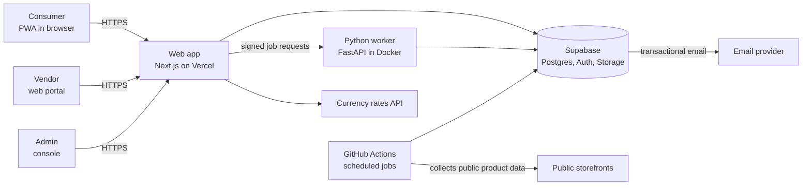
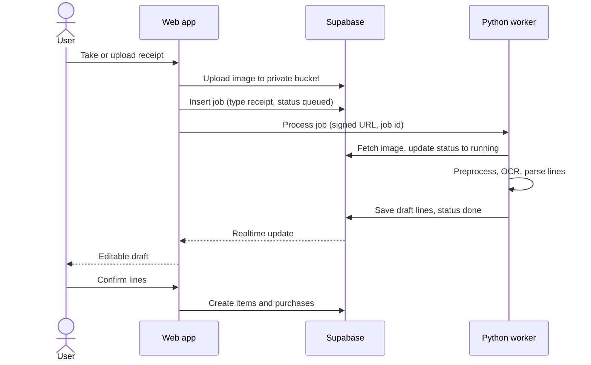
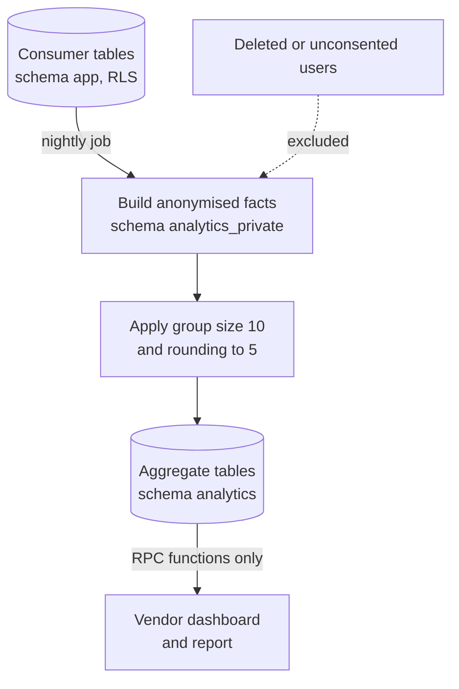
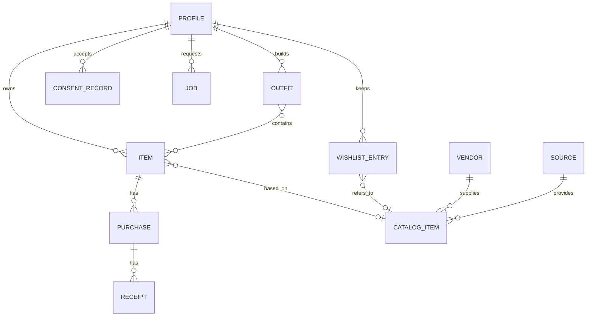

# Sparta: High-Level Design (HLD)

| Field | Value |
| --- | --- |
| Document | High-Level Design |
| Version | 0.1 (draft for SA review) |
| Date | 2026-10-20 |
| Author | Business analyst (drafted for the product owner) |
| Reviewer | C. Prashanth (Solution Architect) |
| Approver | Ambarish Sengupta (Product Owner) |
| Traces to | BRD v0.4 (BR-xx), FDD v0.1 (FR-xx, NFR-xx) |
| Status | Draft. Technology choices were delegated to this document and need SA confirmation. |

## 1. Purpose and scope

This document describes the architecture of the Sparta pilot: the main components, how they interact, where data lives, how privacy is enforced, and how the system is deployed. Class-level and table-level detail is in the LLD.

## 2. Design drivers

| Driver | Source | Effect on the design |
| --- | --- | --- |
| Free or under about $20 a month in total | BRD section 8 | Managed free tiers (Supabase, Vercel, GitHub Actions, a free container host); no always-on paid servers. |
| Team of three, 3-month pilot | BRD section 8 | Few moving parts; one language for the web app; reuse of managed auth, storage and database. |
| About 100 users, room to grow to 500 | FDD NFR-7 | Simple relational design; no distributed systems. |
| Vendors must never see individual data; minimum group of 10 | BR-25, BR-26 | Privacy enforced in the database, not only in the application. |
| Consent recorded; delete and export on request | BR-20 to BR-24 | Consent table, deletion cascade, export job. |
| Web first, installable PWA | BR-13 | Single responsive web app; no native clients in the pilot. |
| Open source under GPL-3.0 | BR-43 | No secrets in the repository; configuration by environment; only components that can be self-hosted. |
| Python for later ML | Earlier product decision | A Python service exists from the start for image, OCR and later ML work. |
| Image and receipt processing | BR-05, BR-06 | Open-source tools in a Python worker. |

## 3. Architecture overview

The design uses four building blocks.

1. **Web app** (Next.js, TypeScript) on Vercel. One codebase serves the consumer PWA, the vendor portal and the minimal admin console, separated by role and route.
2. **Supabase** for Postgres, authentication, file storage, row-level security (RLS) and scheduled database jobs.
3. **Python worker** (FastAPI in a Docker container) for background removal, receipt OCR and parsing, and later ML.
4. **Scheduled jobs** on GitHub Actions for catalogue collection and housekeeping.



*Figure 1. System context and main components.*

### 3.1 Why this shape

- **Most of the app is CRUD** (wardrobe, wishlist, outfits, purchases). With Supabase and RLS, the browser can read and write the user's own rows directly and safely, which removes a whole API layer to build.
- **Heavy and Python-native work stays out of the web tier.** Background removal and OCR need large libraries and memory that serverless web functions handle poorly.
- **Aggregation runs inside Postgres.** Counting distinct users per segment, applying the minimum group size and rounding are set operations, and doing them next to the data keeps raw rows from ever leaving the database.

## 4. Component responsibilities

| Component | Responsibilities | Main requirements |
| --- | --- | --- |
| **Web app, consumer area** | Sign-in and onboarding, pilot notice, wardrobe, filters, item entry, purchases, wishlist, outfit builder and suggestions, calendar, settings, export and delete. Offline caching of viewed pages (service worker). | FR-1 to FR-65, NFR-1 to NFR-5 |
| **Web app, vendor area** | Dashboard, gaps, report view, feed upload and validation. Calls only aggregate functions. | FR-70 to FR-93 |
| **Web app, admin area** | Vendor invitations, catalogue sources, aggregate run monitor, deletion queue, report review. | FR-79, FR-100 to FR-104 |
| **Web server functions** (Vercel route handlers) | Operations that need a secret: invite vendors, start deletion and export, call the worker, generate reports. Use the Supabase service key, which is never sent to the browser. | FR-63, FR-62 |
| **Outfit suggestion logic** | Rule engine running in the web app from a shared rules file, using the user's own items. No server needed. | FR-52 to FR-54, section 14 of FDD |
| **Supabase Auth** | Email, Google and Apple sign-in, email verification, sessions, roles. | FR-1, FR-70 |
| **Supabase Postgres** | All structured data, RLS, aggregate functions, scheduled jobs (`pg_cron`). | all |
| **Supabase Storage** | Private buckets for item images, receipts and exports; signed URLs only. | FR-23, FR-32, FR-46, FR-62 |
| **Python worker** | `POST /photo` background removal and compression; `POST /receipt` OCR and line parsing; later ML. Stateless; reads and writes through Supabase with a scoped key. | FR-23, FR-40 to FR-45 |
| **GitHub Actions** | Scheduled catalogue collection from approved sources, taxonomy mapping, uptime ping to keep the free database from pausing, weekly backup export. | FR-100 to FR-104, NFR-8 |
| **Currency rates API** | Daily rates for display conversion (a free, keyless source such as the ECB-based Frankfurter service). Cached in the database. | FR-33 |
| **Email provider** | Transactional email only: verification, password reset, export ready, deletion confirmation. | FR-60, FR-62, FR-63 |

## 5. Key flows

### 5.1 Item with a photo (FR-23)

1. The browser resizes the image to at most 1,200 pixels on the long side and uploads it to the private item-images bucket.
2. The web app calls the worker with a signed URL and a job ID.
3. The worker removes the background, saves a compressed WebP cut-out to storage, and marks the job done.
4. The browser shows the preview. The user accepts or keeps the original, completes the attributes and saves.

### 5.2 Receipt scan (FR-40 to FR-46)



*Figure 2. Receipt scan sequence.*

Nothing is created in the wardrobe until the user confirms (FR-42). If the free container host is asleep, the first call takes longer; the interface shows a "processing" state and the job is retried automatically up to three times.

### 5.3 Pilot notice and consent (FR-3 to FR-5)

On login the app reads the user's latest consent record. If none exists for the current notice version, a blocking pop-up is shown. Accepting writes a row (user, notice version, time) to the consent table. Until it exists, RLS policies on all consumer tables deny access, so the rule holds even if the client is changed.

### 5.4 Aggregation and vendor views (FR-72 to FR-86)



*Figure 3. Aggregation flow.*

- A nightly `pg_cron` job builds an anonymised fact table: one row per owned, wishlisted or purchased item, with attributes (category, colour, fit, brand, size, season, price band, condition band, region) and a salted hash in place of the user ID. No names, emails, images, receipts, notes or outfit logs enter it.
- The job computes segment counts by distinct hashed user, drops segments below 10, rounds counts to the nearest 5, and writes the results to aggregate tables.
- Vendors have no access to any table. They can only call database functions that read the aggregate tables. Vendor sessions are blocked from the `app` and `analytics_private` schemas by privileges, not only by policy.
- The salt rotates every run, so the hashes cannot be joined across runs.
- Each run writes an audit row (FR-86).

### 5.5 Account deletion and export (FR-62 to FR-64)

- **Delete:** a server function re-authenticates the user, marks the profile as deleting, then deletes the user's rows (foreign keys cascade from the profile), the user's storage objects and finally the auth user. A daily housekeeping job confirms nothing remains, and the 7-day target (FR-64) is monitored.
- **Export:** a server function queues an export job. The worker (or a server function) assembles JSON and the user's files into a zip in a private bucket and the user receives a signed link.

### 5.6 Catalogue collection (FR-100 to FR-104)

A scheduled GitHub Actions job runs a Python collector that reads only from sources marked allowed in the sources table, checks `robots.txt`, rate-limits, identifies itself, extracts attributes and the product URL (not images), maps them to the shared taxonomy, and upserts catalogue items. Unmapped rows go to a review queue in the admin console.

### 5.7 Vendor feed upload (FR-90 to FR-93)

The vendor uploads a CSV or JSON file. A server function validates every row against the shared taxonomy and shows errors. On confirmation the rows are written as vendor catalogue items owned by that vendor.

## 6. Data architecture

### 6.1 Schemas

| Schema | Contents | Who can read |
| --- | --- | --- |
| `app` | Profiles, items, purchases, receipts, wishlist, outfits, collections, tags, consent records, jobs | The owning user (RLS); the service role |
| `catalog` | Catalogue items, sources, vendor feeds, taxonomy tables | All signed-in users for catalogue items; admins for sources |
| `analytics_private` | Anonymised fact table (hashed user, attributes only) | The aggregation job only |
| `analytics` | Aggregate tables and the functions vendors call | Vendors through functions only |
| `ops` | Aggregate run audit, deletion queue, feature flags | Admins |

### 6.2 Core entities



*Figure 4. Core entities.*

### 6.3 Shared taxonomy

The taxonomy (categories, sub-types, colours, fits, materials, patterns, seasons, occasions, condition bands) lives in one versioned JSON file in the repository. It is loaded into database lookup tables, and used by the web app forms, the worker, the collector and the feed validator, so that every source speaks the same vocabulary (BR-40).

### 6.4 Storage budget

Images are resized and stored as WebP; receipts are compressed.

| Item | Assumption | Estimate |
| --- | --- | --- |
| Item images | 100 users x 60 items x about 80 KB | about 480 MB |
| Receipts | 100 users x 10 receipts x about 250 KB | about 250 MB |
| Database rows | Small | under 50 MB |

The free Supabase tier includes about 1 GB of file storage and 500 MB of database, so the estimate is within the limits but with little headroom. Section 11 lists the mitigations.

## 7. Security and privacy architecture

| Concern | Design |
| --- | --- |
| Authentication | Supabase Auth with verified email; Google and Apple sign-in; strong password rules. |
| Authorisation | Roles `consumer`, `vendor`, `admin` in the user's token claims. RLS on every table in `app` so users reach only their own rows. |
| Consent gate | RLS denies consumer access until a consent record exists for the current notice version (section 5.3). |
| Vendor isolation | Vendor sessions have no privileges on `app` or `analytics_private`. They may execute only the aggregate functions in `analytics`. |
| Minimum group size | Enforced inside the aggregation job and again inside each vendor function (defence in depth). |
| Rounding and differencing | Counts rounded to 5; filter combinations that would expose a small group are suppressed (FR-82). |
| Pseudonymisation | Hash with a per-run salt; never stored with the output. |
| Secrets | Service key and worker key only in server-side environment variables on Vercel, GitHub and the worker host. Never in the repository or the browser. |
| Files | Private buckets, short-lived signed URLs, path prefix by user ID. |
| Transport and storage | TLS everywhere; managed encryption at rest by the providers. |
| Input handling | Validated schemas on forms and feed files; upload size and type limits; the worker never executes uploaded content. |
| Scraping conduct | `robots.txt` check, rate limit, identifying user agent, source records (FR-100, FR-101). |
| Logging | No personal data or free text in logs; aggregate run audit kept. |
| Open-source hygiene | Secret scanning in CI; sample environment file only. |

Threats considered: a user reading another user's data (RLS tests), a vendor probing small groups (thresholds, rounding, suppression of differences), service key leaks (server-only use, rotation), abusive uploads (limits), and consent bypass by a modified client (RLS gate).

## 8. Deployment and environments

| Environment | Web | Database and storage | Worker |
| --- | --- | --- | --- |
| Local | `next dev` | Supabase CLI (local containers) | `docker compose` |
| Preview | Vercel preview per pull request | The dev Supabase project | Dev worker |
| Pilot (production) | Vercel production | Prod Supabase project | Container on a free host |

- **Web:** Vercel Hobby. Its terms limit the Hobby plan to non-commercial use, which fits an academic pilot and should be revisited before any paid vendor tier.
- **Database:** two free Supabase projects (dev and prod).
- **Worker host:** a free container host that supports Docker with enough memory for the background-removal model (candidates: Hugging Face Spaces with a Docker space, or a similar free host). The worker has a health endpoint. A cold start is accepted because processing is asynchronous.
- **CI/CD:** GitHub Actions runs lint, type checks, unit tests, RLS tests and a secret scan on each pull request. Merge to main deploys the web app (Vercel) and applies database migrations (Supabase CLI).
- **Keep-alive:** a weekly scheduled request keeps the free Supabase project from pausing during quiet weeks.
- **Backups:** a scheduled job exports the database weekly to a private storage location; a restore is rehearsed once before the pilot opens (NFR-8).

## 9. Non-functional mapping

| NFR | How it is met |
| --- | --- |
| NFR-1 Browsers | Standard web APIs; fallback library for barcode scanning where the browser lacks the native detector. |
| NFR-2 PWA and offline | Web manifest and service worker; cache of viewed pages and wardrobe data; queued writes sync later. |
| NFR-3 Speed | Paginated queries with indexes on user and attributes; thumbnails; static assets on Vercel's CDN. |
| NFR-4 Accessibility | Accessible component library, automated checks in CI, manual pass on main flows. |
| NFR-5 English and translation-ready | All text in message files; currency stored with each amount. |
| NFR-6 Security | Section 7. |
| NFR-7 Capacity | Relational design with indexes comfortably handles 500 users and 50,000 items. |
| NFR-8 Backup and restore | Section 8. |

## 10. Observability and operations

- Web: Vercel logs and analytics, front-end error reporting on a free tier.
- Database: Supabase logs and query statistics; alerts on storage near the limit.
- Worker: structured logs, job success and duration recorded in the `jobs` table.
- Pilot dashboard (internal): registered users, accepted notices, items per user, jobs failing, last aggregate run, segments suppressed. These are the success measures in BRD section 11.
- Analytics events (FDD section 16) are stored in the database with the pseudonymous user ID and no free text.

## 11. Capacity, limits and cost

| Service | Free tier limit that matters | Pilot use | Fallback |
| --- | --- | --- | --- |
| Supabase | 500 MB database, 1 GB storage, pauses after inactivity | Within limits if images are compressed | Weekly ping; delete unused original images; pay for the Pro plan (about $25) only if needed |
| Vercel Hobby | Function time limits, fair-use bandwidth | Light use | Keep heavy work in the worker |
| Worker host | Sleeps when idle, limited memory and CPU | Occasional jobs | Fall back to browser-side background removal; or self-host the container |
| GitHub Actions | Free for public repositories | Daily and weekly jobs | None needed |
| Email provider | Free monthly quota | Transactional only | Supabase default mail for low volume |

The expected pilot cost is zero. The budget ceiling of about $20 a month would not cover Supabase Pro on its own, so the first fallback is storage reduction, then self-hosting.

## 12. Repository layout

```
sparta/
  apps/web/                 Next.js app (consumer, vendor, admin)
  services/worker/          FastAPI worker (photo, receipt, later ML)
  jobs/collector/           Catalogue collector (Python, run on GitHub Actions)
  supabase/
    migrations/             Schema, RLS policies, functions, cron jobs
    seed/                   Taxonomy and sample data
    tests/                  RLS and aggregation tests
  packages/taxonomy/        Shared taxonomy JSON and outfit rules
  docs/                     BRD, FDD, HLD, LLD, charter
  .github/workflows/        CI, deploy, scheduled jobs
  LICENSE                   GPL-3.0
```

## 13. Architecture decisions

For the SA to confirm or change.

| ID | Decision | Alternatives considered | Reason |
| --- | --- | --- | --- |
| AD-1 | Next.js PWA on Vercel | React Native or Flutter | One codebase, no app-store step, fits the 3-person team and web-first decision. |
| AD-2 | Supabase for database, auth, storage and RLS | Own FastAPI plus Postgres | Removes an API layer; RLS gives data-layer privacy; free tier fits. |
| AD-3 | Python worker for image and OCR | Browser-side models; paid APIs | Open-source and free, runs where memory is available, and is the base for later ML. Browser-side is the fallback. |
| AD-4 | Aggregation as SQL in Postgres with `pg_cron` | Python batch job; separate warehouse | Keeps raw data in the database and is simple at pilot scale. |
| AD-5 | Receipt OCR with an open-source engine and rule-based line parsing | Cloud document APIs | Free and consistent with GPL-3.0; accuracy is lower, so the user always confirms (FR-42). |
| AD-6 | Outfit rules run in the web app from a shared rules file | Server-side service | No server needed, easy to review by the style specialist, and a clean seam for a later ML service. |
| AD-7 | Collector on GitHub Actions | Always-on scraper | Free for public repositories; scheduled and auditable. |
| AD-8 | Source images are not stored (links only) | Cache images | Matches the data-sourcing rules in BRD section 9. |

## 14. Risks and open items

| ID | Item | Mitigation or owner |
| --- | --- | --- |
| HR-1 | Storage near the free limit if users add many photos. | Compression, size caps per user, monitor, delete originals after cut-out is accepted. |
| HR-2 | Free worker host sleeps or lacks memory for the background-removal model. | Smaller model, async jobs with retry, browser-side fallback. |
| HR-3 | Receipt OCR accuracy is low on crumpled or non-English receipts. | Always editable draft; manual entry fallback; evaluate on a sample before launch. |
| HR-4 | Free tiers change terms during the pilot. | Keep the design portable (standard Postgres, Docker worker). |
| HR-5 | RLS mistakes expose data. | Automated RLS tests in CI; peer review of all policies by the SA. |
| HR-6 | Small groups make aggregates easy to difference. | Rounding, suppression of differences, review of query shapes. |
| HOI-1 | SA to confirm AD-1 to AD-8, especially the worker host and the OCR engine. | C. Prashanth |
| HOI-2 | Confirm the choice of email provider and Apple sign-in setup effort (Apple needs a paid developer account; Google only is acceptable for the pilot). | Product owner and SA |
| HOI-3 | Decide whether to run a staging environment or rely on Vercel previews and the dev project. | SA |

## 15. Evolution beyond the pilot

- Native apps can reuse the same Supabase backend and shared taxonomy.
- ML recommendations and inspiration matching move into the Python worker, which already exists.
- Vendor billing, promotions and the affiliate flow would need a payments service and a review of free-tier and licence terms.
- A larger user base would move to the paid Supabase plan and a dedicated worker host.
